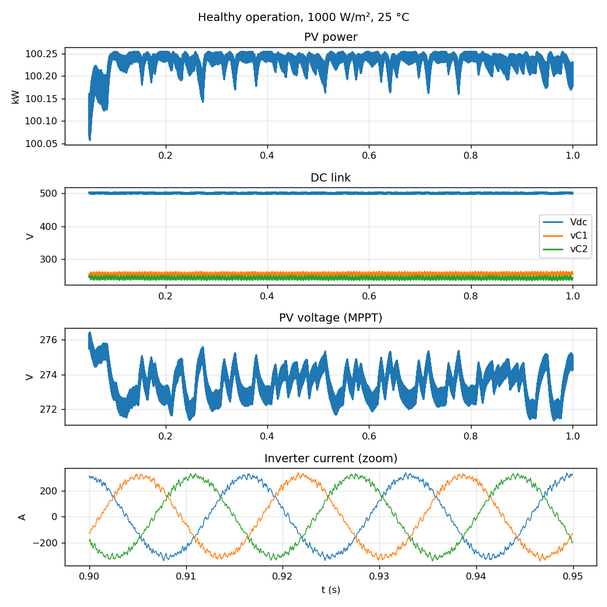
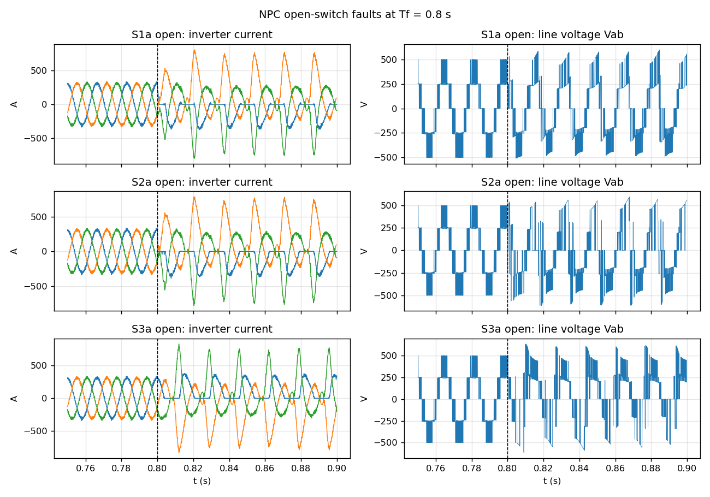
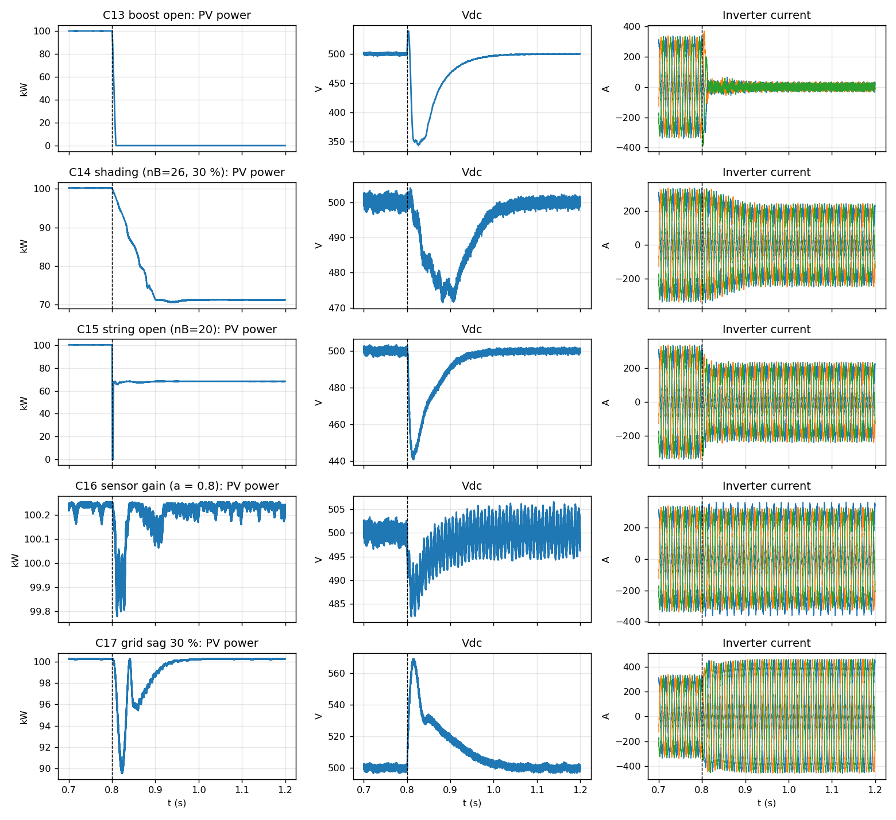

# PV-NPC Fault Simulator (Python)

A MATLAB-free switching simulator of a **100 kW grid-connected PV system with a boost converter and a three-level NPC inverter**, plus a reproducible fault-dataset generator for physics-guided fault diagnosis.

It re-implements the circuit of the MATLAB example `power_PVarray_grid_det` (as modified in `pv_npc_fault.slx`) in Python, compiled with numba. One 1.2 s simulation at a 1 µs step takes about 2 s.

## System modelled

| Stage | Model |
|---|---|
| PV array | 330 × SunPower SPR-305E (5 series × 66 strings), single-diode model, split into Array A (66 − nB strings) and Array B (nB strings) for shading/string faults, bypass diode |
| Boost | 5 mH, 5 kHz PWM, incremental-conductance MPPT with an integral regulator on 1-cycle means |
| DC link | C1 = C2 = 12 mF, 500 V reference |
| Inverter | 3-level NPC, 12 switches, level-shifted PWM at 1980 Hz, switching-function model with clamp/antiparallel diode paths (open-switch faults are physical) |
| Control | SRF-PLL, Vdc PI → Id ref, dq current PI with decoupling, Iq ref = 0, control at 100 µs |
| Grid | 250 µH choke, 10 kvar capacitor bank, 100 kVA 260 V/25 kV transformer leakage, 60 Hz stiff source with programmable sag |

## Fault classes (18) and diagnostic groups (12)

| Class | Fault | Group |
|---|---|---|
| C00 | Healthy | 0 |
| C01–C12 | NPC switch open (S1–S4 of legs a, b, c) | 1–6 (upper/lower pair per leg) |
| C13 | Boost switch open | 7 |
| C14 | Partial shading (13–40 strings, 20–60 % irradiance, 0.05–0.2 s ramp) | 8 |
| C15 | String open (4–20 strings darkened in 1 ms) | 9 |
| C16 | Current-sensor gain fault (one phase reads 10–30 % low) | 10 |
| C17 | Grid voltage sag (10–50 %) | 11 |

## Repository layout

```
pv-npc-fault-sim/
├── pvnpc.py            # plant + controller model
├── test_note.py        # verification checks
├── make_dataset.py     # dataset generator (--sample | --pilot | full)
├── make_summary.py     # builds dataset/summary.csv + dataset/README.md tables
├── make_figures.py     # builds figures/*.png
├── figures/            # all simulation figures (PNG)
├── dataset_csv/        # spreadsheet CSVs: overview (360 rows) + features (15 120 windows)
├── results/            # RESULTS.md, test and baseline outputs
└── dataset/
    ├── README.md       # per-class and per-run tables
    ├── labels.csv      # label table (rendered as a table on GitHub)
    ├── summary.csv     # per-run features
    └── runs/           # run_NNN.npz waveform files
```

## Dataset

The repo includes the **full dataset**: 360 runs (18 classes × 20 weather profiles, 296 MB) in `dataset/runs/`. See [dataset/README.md](dataset/README.md) for the per-class and per-run tables, or open [dataset/labels.csv](dataset/labels.csv) and [dataset/summary.csv](dataset/summary.csv), which GitHub renders as tables. It can be regenerated exactly with `python make_dataset.py`.

Spreadsheet versions (Excel / Google Sheets) are in [dataset_csv/](dataset_csv/): [dataset_overview.csv](dataset_csv/dataset_overview.csv) (one row per run) and [dataset_features.csv](dataset_csv/dataset_features.csv) (one row per 2-cycle window, 58 features + labels), built by `make_csv.py`.

## Quick start

```bash
pip install numpy numba
python test_note.py                 # verification checks (~30 s)
python make_dataset.py --sample     # 18-run sample, one per class (~1 min)
python make_dataset.py --pilot      # 20-run pilot (~1 min)
python make_dataset.py              # full 360 runs (18 classes x 20 weather profiles)
python make_summary.py              # rebuild dataset tables
python ml_baseline.py               # random-forest baseline T1/T2/T3
python pv_check.py                  # exact PV maximum power
```

The dataset generator:
- writes one file per run (`dataset/runs/run_001.npz` … `run_360.npz`), 0.2 s before to 0.4 s after the fault at 20 kHz, in float32;
- is crash-safe: re-running skips finished runs, and files are written atomically;
- is reproducible: run *n* uses seed 1000 + *n*;
- writes `labels.csv` (class, group, switch, profile, G, T, Tf, fault parameters) and `run_log.csv`;
- runs in parallel on all CPU cores but one.

Load a run:
```python
import numpy as np
d = np.load('dataset/runs/run_014.npz')
X, cols = d['data'], list(d['cols'])   # columns: t, Iinv_abc, Iabc_abc, Imeas_abc, Vabc, Vab, Vdc, vC1, vC2, vC3, Vpv, Ipv, G, D
```

## Verification

| Check | Python | Reference (Simulink) |
|---|---|---|
| Healthy PV power, 1000 W/m² 25 °C | 100.2 kW | 100.4 kW |
| Grid / inverter current peak | 3.24 A / 311 A | 3.29 A / 318 A |
| Vdc | 500 V | 500 V |
| Boost open: PV power / voltage | 0 kW / 320.6 V | 0 / 320.8 V |
| Shading nB = 26, 30 % | 71.2 kW | 72.4 kW |
| String open nB = 10 / 20 | 84.3 / 68.3 kW | 84.8 / 69.7 kW |
| 30 % sag current ratio | 1.428 | 1.423 |
| 200 W/m² | 16.7 kW | 19.3 kW |

The MPPT reaches the true maximum power point at every irradiance. `pv_check.py` solves the PV equation exactly with the Simulink module parameters: 100.4 kW at 273.5 V at 1000 W/m², but only 16.7 kW at 200 W/m². The 19.3 kW reference value at 200 W/m² is therefore above the physical maximum of that array.

**S1 vs S2 open faults:** with explicit diode paths, an S2 open fault sends the positive half-cycle current to −Vdc/2, while an S1 open fault sends it only to the midpoint. The phase current differs by about 6 % and the line voltage by about 70 %, so the two faults may be separable.

## Results summary

Full details: [results/RESULTS.md](results/RESULTS.md)

- **Full dataset:** 360 runs generated in **8.4 min**, 0 errors, 296 MB, all included in `dataset/runs/`.
- **Verification:** 11/13 checks agree with the Simulink reference values; the 2 low-irradiance mismatches are explained above.
- **Random-forest baseline** (run-grouped splits, 2-cycle windows):

| Test | 12 groups acc | 18 classes acc |
|---|---|---|
| T1 same weather (normalised) | 86.8 % | 85.7 % |
| T2 unseen low irradiance, raw → normalised | 79.3 → **88.9 %** | 51.2 → **75.7 %** |
| T3 fixed → changing weather (normalised) | 88.2 % | 86.9 % |

- Switch faults C01–C12 are classified individually at 94–100 %, and all errors stay inside the S1/S2 or S3/S4 pair. The weak point is healthy vs shading vs string open, which look alike after the transient.

## Simulation figures

Generated with `python make_figures.py`. The fault is applied at Tf = 0.8 s (dashed line).

**Healthy operation**: PV power ≈ 100.2 kW at MPP, Vdc held at 500 V, sinusoidal inverter current.



**NPC open-switch faults (S1a, S2a, S3a)**: the affected phase loses one half-cycle. S1a and S2a give similar currents but different line-voltage patterns.



**Boost, shading, string, sensor and grid-sag faults**:



## Limitations
- This is an independent re-implementation, not the Simulink model. Control gains are tuned here.
- The grid is a stiff source behind the transformer leakage impedance (no feeder or loads). The transformer is linear and the Δ-Y phase shift is ignored.
- No neutral-point balancing control and no protection trips are modelled.

## Files
- `pvnpc.py`: plant + controller model (`run(...)` returns a 20 kHz log array)
- `test_note.py`: verification checks
- `make_dataset.py`: dataset generator
- `make_figures.py`: README figures
- `make_summary.py`: dataset tables
- `ml_baseline.py`: random-forest baseline
- `make_csv.py`: spreadsheet CSVs in `dataset_csv/`
- `pv_check.py`: exact PV maximum power
- `results/`: test, baseline and PV-check outputs
